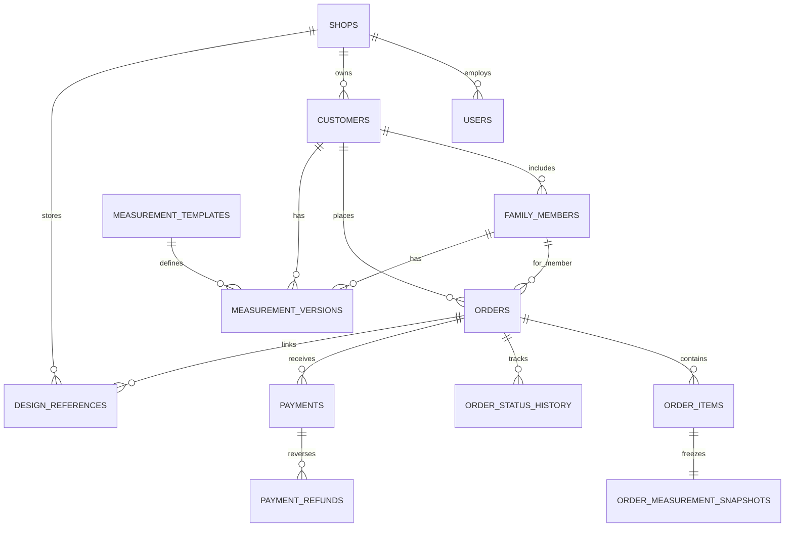

# TailorBook — Database Design & Data Architecture

## 1. Overview
TailorBook utilizes a dual-database model:
1. **Local Embedded Database**: Android Room (SQLite) acting as the offline single source of truth.
2. **Cloud Remote Database**: Supabase-managed PostgreSQL with Row Level Security (RLS) enforcing tenant isolation per shop.

Both databases mirror the same relational entity schema and UUID-based primary keys to avoid ID collision and simplify synchronization.

---

## 2. Entity-Relationship Diagram (Conceptual)

---

## 3. Relational Schema Specification

### 3.1 `shops`
Represents the tailoring business / boutique.
- `id`: UUID (Primary Key)
- `name`: TEXT NOT NULL
- `owner_id`: UUID NOT NULL
- `phone`: TEXT NOT NULL
- `address`: TEXT
- `category`: TEXT (Gents, Ladies, Unisex, Boutique)
- `currency_symbol`: TEXT DEFAULT '₹'
- `default_measurement_unit`: TEXT DEFAULT 'INCH' (INCH / CM)
- `created_at`: TIMESTAMPTZ NOT NULL
- `updated_at`: TIMESTAMPTZ NOT NULL

### 3.2 `users` & `shop_memberships`
Staff and owner accounts.
- `users`: `id` (UUID), `auth_id` (UUID), `name`, `phone`, `email`, `created_at`
- `shop_memberships`: `id` (UUID), `shop_id` (UUID FK), `user_id` (UUID FK), `role` (`OWNER`, `MANAGER`, `WORKER`), `is_active` (BOOLEAN), `created_at`

### 3.3 `customers`
- `id`: UUID (Primary Key)
- `shop_id`: UUID NOT NULL (FK shops)
- `name`: TEXT NOT NULL
- `primary_phone`: TEXT NOT NULL
- `secondary_phone`: TEXT
- `gender`: TEXT (MALE, FEMALE, OTHER)
- `address`: TEXT
- `notes`: TEXT
- `is_archived`: BOOLEAN DEFAULT FALSE
- `created_at`: TIMESTAMPTZ NOT NULL
- `updated_at`: TIMESTAMPTZ NOT NULL
- *Indexes*: `(shop_id, primary_phone)`, `(shop_id, name)`

### 3.4 `family_members`
- `id`: UUID (Primary Key)
- `customer_id`: UUID NOT NULL (FK customers ON DELETE CASCADE)
- `shop_id`: UUID NOT NULL (FK shops)
- `name`: TEXT NOT NULL
- `relationship`: TEXT NOT NULL (Wife, Daughter, Son, Husband, Mother, Father, Other)
- `gender`: TEXT
- `notes`: TEXT
- `created_at`: TIMESTAMPTZ NOT NULL
- `updated_at`: TIMESTAMPTZ NOT NULL

### 3.5 `measurement_templates`
Pre-configured garment definitions (Blouse, Shirt, Pants, Kurti, etc.)
- `id`: TEXT (Primary Key, e.g., 'BLOUSE', 'SHIRT', 'PANTS', 'KURTI', 'DRESS', 'CHURIDAR', 'TSHIRT', 'CUSTOM')
- `name_en`: TEXT NOT NULL
- `name_te`: TEXT NOT NULL
- `default_fields_json`: TEXT NOT NULL (JSON array of measurement field keys, min/max range, guide diagrams)
- `created_at`: TIMESTAMPTZ NOT NULL

### 3.6 `measurement_versions`
Historical versions of measurements for a customer or family member.
- `id`: UUID (Primary Key)
- `shop_id`: UUID NOT NULL (FK shops)
- `customer_id`: UUID NOT NULL (FK customers)
- `family_member_id`: UUID (FK family_members NULLable)
- `template_id`: TEXT NOT NULL (FK measurement_templates)
- `version_number`: INTEGER NOT NULL (1, 2, 3...)
- `measurements_json`: TEXT NOT NULL (Key-value map of measured dimensions)
- `unit`: TEXT NOT NULL DEFAULT 'INCH'
- `notes`: TEXT
- `measured_at`: TIMESTAMPTZ NOT NULL
- `created_by`: UUID (FK users)
- `created_at`: TIMESTAMPTZ NOT NULL
- *Unique Constraint*: `(customer_id, family_member_id, template_id, version_number)`

### 3.7 `orders`
Master order record.
- `id`: UUID (Primary Key)
- `shop_id`: UUID NOT NULL (FK shops)
- `order_number`: TEXT NOT NULL (e.g. `TB-00102`)
- `customer_id`: UUID NOT NULL (FK customers)
- `family_member_id`: UUID (FK family_members NULLable)
- `order_date`: TIMESTAMPTZ NOT NULL
- `promised_delivery_date`: TIMESTAMPTZ NOT NULL
- `actual_delivery_date`: TIMESTAMPTZ
- `status`: TEXT NOT NULL (`NEW`, `CUTTING`, `STITCHING`, `FINISHING`, `READY`, `DELIVERED`, `CANCELLED`)
- `total_amount`: DECIMAL(10, 2) NOT NULL
- `advance_amount`: DECIMAL(10, 2) NOT NULL DEFAULT 0.00
- `discount_amount`: DECIMAL(10, 2) NOT NULL DEFAULT 0.00
- `paid_amount`: DECIMAL(10, 2) NOT NULL DEFAULT 0.00
- `balance_amount`: DECIMAL(10, 2) NOT NULL
- `cancellation_reason`: TEXT
- `assigned_staff_id`: UUID (FK users NULLable)
- `created_at`: TIMESTAMPTZ NOT NULL
- `updated_at`: TIMESTAMPTZ NOT NULL

### 3.8 `order_items`
Garments inside an order.
- `id`: UUID (Primary Key)
- `order_id`: UUID NOT NULL (FK orders ON DELETE CASCADE)
- `garment_template_id`: TEXT NOT NULL
- `garment_name`: TEXT NOT NULL
- `quantity`: INTEGER NOT NULL DEFAULT 1
- `unit_price`: DECIMAL(10, 2) NOT NULL
- `stitching_instructions`: TEXT
- `fabric_details`: TEXT
- `created_at`: TIMESTAMPTZ NOT NULL

### 3.9 `order_measurement_snapshots`
**CRITICAL**: Immutable copy of measurements captured at the time of order booking.
- `id`: UUID (Primary Key)
- `order_id`: UUID NOT NULL UNIQUE (FK orders ON DELETE CASCADE)
- `measurement_version_id`: UUID NOT NULL (FK measurement_versions)
- `frozen_measurements_json`: TEXT NOT NULL (Exact snapshot JSON)
- `unit`: TEXT NOT NULL
- `created_at`: TIMESTAMPTZ NOT NULL

### 3.10 `order_status_history`
Audit timeline of all status movements.
- `id`: UUID (Primary Key)
- `order_id`: UUID NOT NULL (FK orders ON DELETE CASCADE)
- `from_status`: TEXT
- `to_status`: TEXT NOT NULL
- `notes`: TEXT
- `changed_by`: UUID (FK users)
- `timestamp`: TIMESTAMPTZ NOT NULL

### 3.11 `payments`
Immutable financial transaction ledger.
- `id`: UUID (Primary Key)
- `shop_id`: UUID NOT NULL (FK shops)
- `order_id`: UUID NOT NULL (FK orders)
- `customer_id`: UUID NOT NULL (FK customers)
- `amount`: DECIMAL(10, 2) NOT NULL
- `payment_method`: TEXT NOT NULL (`CASH`, `UPI`, `BANK_TRANSFER`, `CHEQUE`, `OTHER`)
- `reference_number`: TEXT (e.g., UPI Transaction ID)
- `payment_date`: TIMESTAMPTZ NOT NULL
- `notes`: TEXT
- `received_by`: UUID (FK users)
- `is_reversed`: BOOLEAN DEFAULT FALSE
- `created_at`: TIMESTAMPTZ NOT NULL

### 3.12 `payment_refunds`
Reversals and refunds for payments.
- `id`: UUID (Primary Key)
- `payment_id`: UUID NOT NULL (FK payments)
- `order_id`: UUID NOT NULL (FK orders)
- `amount`: DECIMAL(10, 2) NOT NULL
- `reason`: TEXT NOT NULL
- `refund_method`: TEXT NOT NULL
- `refund_date`: TIMESTAMPTZ NOT NULL
- `approved_by`: UUID NOT NULL (FK users)
- `created_at`: TIMESTAMPTZ NOT NULL

### 3.13 `design_references`
Photographs and sketches.
- `id`: UUID (Primary Key)
- `shop_id`: UUID NOT NULL (FK shops)
- `customer_id`: UUID (FK customers NULLable)
- `order_id`: UUID (FK orders NULLable)
- `local_file_path`: TEXT NOT NULL
- `remote_storage_url`: TEXT
- `tags`: TEXT
- `notes`: TEXT
- `sync_status`: TEXT DEFAULT 'PENDING' (`PENDING`, `UPLOADED`, `FAILED`)
- `created_at`: TIMESTAMPTZ NOT NULL

### 3.14 `sync_queue` (Local SQLite only)
Offline mutation queue processed by WorkManager.
- `id`: UUID (Primary Key)
- `entity_type`: TEXT NOT NULL (CUSTOMER, ORDER, PAYMENT, etc.)
- `entity_id`: UUID NOT NULL
- `operation`: TEXT NOT NULL (`INSERT`, `UPDATE`, `DELETE`)
- `payload_json`: TEXT NOT NULL
- `status`: TEXT NOT NULL (`PENDING`, `SYNCING`, `FAILED`, `SYNCED`)
- `retry_count`: INTEGER DEFAULT 0
- `last_error`: TEXT
- `created_at`: INTEGER NOT NULL (Epoch ms)
- `updated_at`: INTEGER NOT NULL
